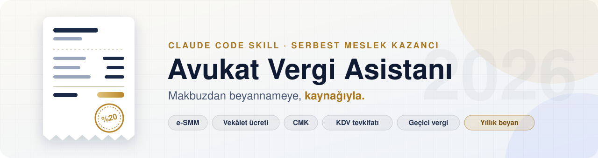
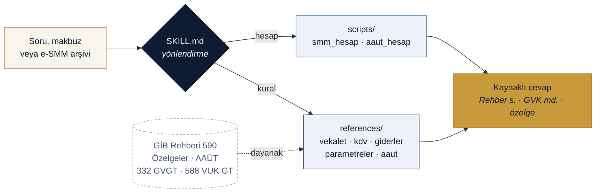

<div align="center">

<picture>
  <source media="(prefers-color-scheme: dark)" srcset="assets/banner-dark.svg">
  <source media="(prefers-color-scheme: light)" srcset="assets/banner-light.svg">
  
</picture>

<br/>

[](https://github.com/hasanimer/avukat-vergi-skill/actions/workflows/validate.yml)


[](LICENSE)

**[Kurulum](#-kurulum)** · **[Örnekler](#-örnekler)** · **[Ne sorabilirsiniz?](#-ne-sorabilirsiniz)** · **[Kaynaklar](#-kaynaklar)** · **[Yol haritası](#-yol-haritası)**

</div>

<br/>

Serbest çalışan avukatın **kendi** vergi işleri için bir Claude Code skill'i:
- **Makbuz:** e-SMM'de stopaj, KDV ve tevkifat hesabı.
- **Vekâlet ücreti:** karşı taraf vekâlet ücretinde makbuzun kime kesileceği.
- **Ek gelirler:** CMK ve adli yardım ücretleri.
- **Vergi ve giderler:** geçici vergi, yıllık beyan ve gider yazma.

Her cevap bir **GİB rehberi sayfasına, özelgeye ya da mevzuat maddesine** dayanır. Hesaplar ise kuruşu kuruşuna doğrulanmış betiklerle yapılır.

<table>
<tr>
<td align="center" width="25%"><h3>590</h3><sub>GİB Serbest Meslek Kazancı Rehberi<br/>(Şubat 2026), sayfa referanslı</sub></td>
<td align="center" width="25%"><h3>450+</h3><sub>avukatlıkla ilgili GİB özelgesi<br/>tarandı ve sınıflandırıldı</sub></td>
<td align="center" width="25%"><h3>2026</h3><sub>tarife, had ve cezalar<br/>332 GVGT · 588 VUK GT · 71 DVK GT</sub></td>
<td align="center" width="25%"><h3>45 ✓</h3><sub>öz-sınama: Rehber örnekleri,<br/>2026 tarifesi, AAÜT</sub></td>
</tr>
</table>

## ✦ Ne yapar?

<table>
<tr>
<td width="50%" valign="top">

### 01 · Makbuz hesabı
e-SMM'yi dört başlangıç noktasından çıkarır: brüt, net, tahsil edilecek tutar veya **KDV dahil vekâlet ücreti**.
- %20 stopaj
- %20 ya da %10 KDV
- Kamu alıcılarda **5/10 KDV tevkifatı**. Tevkifat sınırı işlem tarihine göre otomatik seçilir.

</td>
<td width="50%" valign="top">

### 02 · e-SMM arşiv denetimi
GİB'den indirdiğiniz XML arşivini (zip ya da klasör) okur ve ay ile çeyrek toplamlarını çıkarır. Şunları yakalar:
- Eksik ya da gereksiz tevkifat
- Gerçek kişiden kesilmiş stopaj
- %10 olması gereken KDV
- Yurt dışındaki alıcı

</td>
</tr>
<tr>
<td width="50%" valign="top">

### 03 · Vekâlet ücreti → makbuz
AAÜT'ye göre nispi ve maktu ücreti hesaplar (md. 11, 13, 16), sonra vergiye çevirir:
- Tevkifatı kim yapar?
- Makbuz kime kesilir?
- Kararda "KDV hariç" yazmıyorsa KDV iç yüzdeyle nasıl ayrılır?

</td>
<td width="50%" valign="top">

### 04 · Geçici ve yıllık vergi
**Kümülatif** geçici vergiyi stopaj mahsubuyla hesaplar. Yıllık beyanda şunları uygular:
- İndirim sınırları
- %5 uyum indirimi
- Mahsup ve iade

</td>
</tr>
</table>

## ✦ Nasıl çalışır?



## ⚡ Kurulum

> **Gerekenler:** Claude Code ve Python 3.9+. Betikler yalnız standart kütüphaneyi kullanır; API anahtarı gerekmez.

```bash
git clone https://github.com/hasanimer/avukat-vergi-skill.git ~/.claude/skills/avukat-vergi
```

Kurulumu doğrulayın:

```bash
cd ~/.claude/skills/avukat-vergi && python3 scripts/smm_hesap.py test && python3 scripts/aaut_hesap.py test
```

> [!TIP]
> Muhasebe klasörünüzü, e-SMM arşivinizin yolunu ve vergi dairenizi `references/kullanici-profili.local.md` dosyasına yazın. Skill bu dosyayı okur; dosya `.gitignore` ile depo dışında kalır.

## 🧾 Örnekler

<details open>
<summary><b>CMK makbuzu</b>: Başsavcılığa KDV dahil 14.400 TL (2026 tevkifat sınırı 12.000 TL aşılıyor)</summary>

```console
$ python3 scripts/smm_hesap.py makbuz --kdv-dahil 14400 --kdv-tevkifat 5/10
┌────────────────────────────────────────────────────┐
│ Brüt ücret (KDV hariç)                   12.000,00 │
│ GV stopajı %20                           −2.400,00 │
├────────────────────────────────────────────────────┤
│ Net ücret                                 9.600,00 │
│ KDV %20                                   2.400,00 │
│ KDV tevkifatı (5/10)                     −1.200,00 │
├────────────────────────────────────────────────────┤
│ Tahsil edilecek                          10.800,00 │
└────────────────────────────────────────────────────┘
  KDV dahil makbuz toplamı: 14.400,00 · KDV1'de beyan edilecek KDV: 1.200,00
```

</details>

<details>
<summary><b>Karşı taraf vekâlet ücreti</b>: 250.000 TL'lik asliye hukuk davası, borçlu bir şirket</summary>

```console
$ python3 scripts/aaut_hesap.py karsi-taraf 250000 --mahkeme asliye
Vekalet ücreti: 45.000,00 TL (KDV dahil kabul — 311 GVGT md.25/5)
  e-SMM brüt (KDV hariç): 37.500,00
  KDV %20: 7.500,00
  GV stopajı: 7.500,00
  KDV tevkifatı: 0,00
  Avukata ödenecek: 37.500,00
  Makbuz: borçlu (davayı kaybeden) adına; icra müdürlüğüne nüsha gerekmez (311 GVGT md.26).
NOT: Nispi ücret (40.000,00) maktu ücretin (45.000,00) altında: maktu uygulanır (md.13/1).
NOT: Mahkeme tarifedeki miktarın 3 katına kadar hükmedebilir (md.3/1); bu asgari tutardır.
```

</details>

<details>
<summary><b>Geçici vergi</b>: kümülatif hesap; stopaj ve önceki ödemeler mahsup edilir</summary>

```console
$ python3 scripts/smm_hesap.py gecici --donem 400000,90000,20000 --donem 350000,80000,15000 --donem 420000,95000,10000
Dönem     Küm. matrah   Hesaplanan  Küm. stopaj  Önce ödenen    ÖDENECEK
Ç1         310.000,00    46.500,00    20.000,00         0,00   26.500,00
Ç2         580.000,00    87.000,00    35.000,00    26.500,00   25.500,00
Ç3         905.000,00   135.750,00    45.000,00    52.000,00   38.750,00
Oran %15; kesilen stopaj ve önceki dönemlerde ödenen geçici vergi mahsup edilir (Rehber s.28-29).
```

</details>

<details>
<summary><b>e-SMM arşiv denetimi</b>: <code>examples/ornek-esmm</code> (uydurma verilerle)</summary>

```console
$ python3 scripts/smm_hesap.py esmm-ozet examples/ornek-esmm
== ÇEYREK (geçici vergi dönemi) ==
dönem      adet           brüt          KDV   KDV tevk.   beyan KDV*    GV stopaj         tahsil
2026-Ç1       2      17.753,33     3.550,67    1.200,00     2.350,67     3.550,67      16.553,33
2026-Ç2       1      50.000,00    10.000,00        0,00    10.000,00    10.000,00      50.000,00
2026-Ç3       3      60.000,00    12.000,00        0,00    12.000,00     8.000,00      64.000,00

== UYARILAR ==
ORN…004  ÖRNEK MÜVEKKİL: gerçek kişi alıcıda stopaj var — alıcı tacir/serbest meslek erbabı değilse stopaj yapılmaz
ORN…004  ÖRNEK MÜVEKKİL: aile/tüketici/çocuk mahkemesi, vesayet veya adli yardım işi: KDV %10 olabilir
ORN…005  ÖRNEK CUMHURİYET BAŞSAVCILIĞI: KDV dahil 18.000,00 > 12.000,00: 5/10 KDV tevkifatı beklenirdi
ORN…006  ÖRNEK YURTDIŞI MÜVEKKİL: alıcı adresi Almanya: KDVK 11/1-a istisnası değerlendirilmeli
```

</details>

## 💬 Ne sorabilirsiniz?

| Konu | Örnek soru |
|---|---|
| **Makbuz** | *"Gerçek kişi müvekkilden net 10.000 TL eline geçecek şekilde makbuz keseceğim; brüt ne olmalı?"* |
| **Vekâlet ücreti** | *"Borçlu şirket vekâlet ücretini icraya yatırdı ama stopaj kesmedi. Makbuzu kime keserim, beyanda ne olur?"* |
| **KDV'nin doğması** | *"Ücretsiz aldığım dava kesinleşti; KDV ödeyecek miyim, makbuzu nasıl düzenlerim?"* |
| **CMK / adli yardım** | *"Çocuk mahkemesindeki CMK görevim için KDV kaç? Baroya keseceğim adli yardım makbuzunda tevkifat var mı?"* |
| **Tevkil / ortak vekâlet** | *"Tevkil ücretimin makbuzunu kime keserim? Ortak takip ettiğimiz işin ücretini nasıl belgeleriz?"* |
| **Giderler** | *"Ev-ofis kiramı, aracımı ve baro aidatımı nasıl gider yazarım?"* |
| **Beyan** | *"2026 üçüncü dönem geçici vergimi hesapla."* · *"%5 uyum indiriminden yararlanabilir miyim?"* |
| **Arşiv** | *"Şu e-SMM XML arşivini özetle ve hataları göster."* |

<details>
<summary><b>Komut referansı</b></summary>

```text
scripts/smm_hesap.py makbuz       --brut | --net | --tahsil | --kdv-dahil  [--stopaj 20|17|0] [--kdv 20|10] [--kdv-tevkifat 5/10]
scripts/smm_hesap.py vergi        <matrah> [--yil 2026] [--ucret]
scripts/smm_hesap.py gecici       --donem hasılat,gider,stopaj   (her çeyrek için bir kez)
scripts/smm_hesap.py yillik       --yil 2025 --hasilat … --gider … --bagkur … --tevkifat … [--uyum-indirimi] [--json]
scripts/smm_hesap.py esmm-ozet    <arşiv.zip | klasör | dosya.xml> [--yil 2026] [--csv çıktı.csv]
scripts/smm_hesap.py parametre    --yil 2026
scripts/aaut_hesap.py karsi-taraf <değer> --mahkeme asliye [--tur dava|icra|arabuluculuk-anlasma] [--odeme-suresinde]
scripts/aaut_hesap.py karsi-taraf --hukmedilen 45000 [--kdv 10] [--kdv-haric] [--odeyen-gercek-kisi] [--kdv-tevkifat 5/10]
scripts/aaut_hesap.py maktu | nispi <değer>
scripts/ozelge_guncelle.py        [--terim avukat] [--sadece-yeni]
```

</details>

## 📚 Kaynaklar

| | Kaynak | Skill'deki yeri |
|:---:|---|---|
| 📘 | GİB, *Serbest Meslek Kazancı Elde Eden Mükellefler İçin Vergi Rehberi*, Şubat 2026, Yayın No 590 | [`rehber-590-avukat.md`](references/rehber-590-avukat.md) |
| 🧮 | 332 Seri No.lu GVGT · 588 Sıra No.lu VUK GT · 71 Seri No.lu DVK GT (RG 31.12.2025, 33124 5. Mük.) | [`parametreler.md`](references/parametreler.md) |
| ⚖️ | Avukatlık Asgari Ücret Tarifesi (RG 04.11.2025, 33067; değişiklikler 08.01.2026 ve 28.03.2026) | [`aaut-2025-2026.md`](references/aaut-2025-2026.md) |
| 🧾 | KDV GUT I/C-2.1.3.2.13 ve I/C-2.1.3.4.1 · Seri 36 ve 50 · 2007/13033 BKK (II) 32 | [`kdv.md`](references/kdv.md) |
| 📄 | GVK 94/3 · 311 Seri No.lu GVGT md. 25–26 · GİB özelgeleri | [`vekalet-ucreti.md`](references/vekalet-ucreti.md) |
| 🎓 | TBB Eğitim Merkezi, *Avukatın Vergilendirilmesi* çevrim içi eğitimi (Av. Oğuzhan Aslan, 2025). Uygulama notları, güncel mevzuatla karşılaştırmalı | [`uygulama-notlari.md`](references/uygulama-notlari.md) |

<details>
<summary><b>Doğrulama: Rehber örnekleri kuruşu kuruşuna</b></summary>

`python3 scripts/smm_hesap.py test` komutu Rehber'deki sayısal örnekleri yeniden hesaplar:

| Örnek | Konu | Rehber | Skill |
|---|---|---:|:---:|
| C | Avukat; %5 uyum indirimi, ödenecek | 903.945 TL | ✓ |
| 1 | Avukat; konut kirası, mesken istisnası yok | 1.164.300 TL | ✓ |
| 2 | Doktor; sağlık sigortası indirimi | 486.175 TL | ✓ |
| 3 | Mimar; telif istisnası ve bağış | 669.400 TL | ✓ |
| 4 | SMMM; engellilik indirimi | 705.170 TL | ✓ |
| 5 | Diş hekimi; iş yeri kirası | 1.672.240 TL | ✓ |
| 6 | Ressam; telif sınırı aşımı | 426.950 TL | ✓ |
| 7 | Avukat; ev-ofis, telif, Bağ-Kur, %5 indirim | 273.860,50 TL | ✓ |

Ayrıca şunlar sınanır:
- 2026 tarifesinin sabit tutarları (332 GVGT)
- UHAP CMK dökümü (iç yüzde ve 5/10 tevkifat)
- AAÜT nispi ve maktu hesapları

CI bu testleri her push'ta çalıştırır.

</details>

## 🗺 Yol haritası

- [x] GİB Rehberi 590: avukat odaklı özet ve tam metin
- [x] 2026 parametreleri: tarife, had, ceza, damga vergisi, Bağ-Kur
- [x] AAÜT 2025–2026 tabloları, değişiklikleri ve vergiye çeviri
- [x] KDV tevkifatı, CMK ve adli yardım: birincil kaynaktan doğrulanmış bulgular
- [x] Hesap araçları ve e-SMM XML arşiv denetimi
- [x] TBB eğitiminden uygulama notları, güncel mevzuatla karşılaştırmalı
- [ ] Özelge sentezi: e-SMM ve belge düzeni, giderler, yan faaliyetler (arabuluculuk, bilirkişilik, kayyımlık), mükellefiyet, damga vergisi
- [ ] Gerçekçi avukat senaryolarıyla değerlendirme seti
- [ ] Kasım 2026 AAÜT ve Ocak 2027 parametre güncellemesi

## ⚠️ Uyarı

> [!WARNING]
> Bu skill bilgi amaçlıdır; mali müşavirlik ya da hukuki görüş yerine geçmez.
> - **Özelgeler yalnızca talep eden mükellefi bağlar** (VUK 413).
> - Tutar ve oranlar her yıl değişir. Beyan ve ödeme öncesinde güncel tebliğleri ve GİB duyurularını kontrol edin.

## Lisans

Kod ve özgün metinler [MIT](LICENSE) lisanslıdır. GİB yayınları, Resmî Gazete metinleri ve özelgeler resmî belgelerdir; kaynak gösterilerek alıntılanmıştır.

<div align="center">
<br/>
<sub>Av. Hasan İmer Akın tarafından, Claude Code ile hazırlandı · <a href="https://github.com/hasanimer">@hasanimer</a></sub>
</div>
